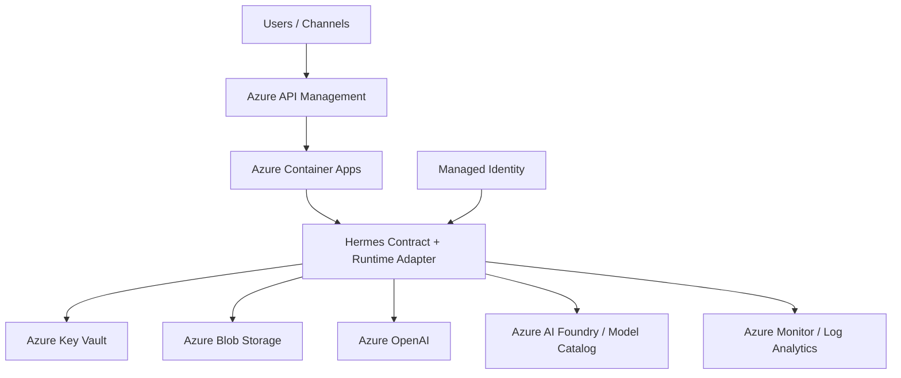

# Architecture Design

This document defines the Azure-native target architecture for hosting **Hermes Agent on Azure**.

It is designed for workshop delivery, but it follows production-oriented thinking and explicitly maps to:

- **Azure Cloud Adoption Framework (CAF)**
- **Azure Well-Architected Framework (WAF)**

---

## 1. Design goals

The architecture should be:

- simple enough to explain in a 120-minute workshop
- structured enough for enterprise discussion
- modular enough to evolve into a customer starter repo
- aligned to Azure landing-zone thinking

---

## 2. High-level architecture

### Component summary

#### Azure API Management
Used as the governed public ingress layer for webhook-style channels.

Responsibilities:
- normalize public endpoints
- apply throttling and policy
- isolate external channel concerns from the runtime
- add diagnostics and correlation headers

#### Azure Container Apps
Used as the runtime platform for Hermes Agent.

Responsibilities:
- host Hermes Agent in a serverless container model
- expose HTTP ingress
- support health and readiness checks
- support revision-based deployment

#### Hermes contract + runtime adapter
Used as the runtime boundary inside the container.

Responsibilities:
- keep the HTTP contract stable
- centralize provider bootstrap
- centralize workspace restore/save lifecycle
- provide a seam for plugging in a real Hermes runtime later

#### Azure Blob Storage
Used for workspace persistence.

Responsibilities:
- persist `.hermes` workspace state
- replace S3-style state sync from the AWS sample
- support memory/session continuity across revisions

#### Azure Key Vault
Used for secrets and configuration references.

Responsibilities:
- store bot tokens and endpoint secrets
- reduce hard-coded credential usage
- align to enterprise secret management expectations

#### Azure OpenAI / Azure AI Foundry
Used as the model provider layer.

Responsibilities:
- support GPT-family path through Azure OpenAI
- support multi-model / Claude path through Azure AI Foundry

#### Azure Monitor / Log Analytics
Used for observability.

Responsibilities:
- runtime logging
- health and failure investigation
- workshop demo telemetry and operations visibility

---

## 3. Data flow

### Inbound request flow

1. External channel sends request to APIM
2. APIM applies policy, route mapping, throttling, and correlation headers
3. Request is forwarded to Container Apps ingress
4. Hermes contract endpoint receives `/invocations`
5. Runtime adapter applies provider and lifecycle context
6. Hermes calls Azure OpenAI or Azure AI Foundry
7. Response returns through the same chain

### Persistence flow

1. Container starts
2. Blob-backed workspace state is restored
3. Hermes runtime processes messages
4. Periodic sync writes updated workspace state back to Blob Storage
5. On shutdown, a final save is attempted before exit

---

## 4. CAF alignment

| CAF area | Architecture decision | Why it matters |
|---|---|---|
| Identity | Managed Identity + RBAC | avoids static credentials and supports enterprise access control |
| Networking | APIM + Container Apps + private-access ready pattern | supports landing-zone friendly ingress design |
| Management | Log Analytics + operational scripts | supports repeatable deployment and supportability |
| Governance | phase-based IaC and explicit resource structure | supports policy-driven enterprise rollout |
| Security | Key Vault, MI, segmented ingress, future private endpoint support | improves control over secrets and exposure |
| Platform Automation | Bicep + Terraform + deployment scripts | makes the repo reusable as a platform asset |

---

## 5. WAF alignment

| WAF pillar | Current architecture choice | Intent |
|---|---|---|
| Reliability | healthz / readyz, workspace restore/save, shutdown flush | keep runtime available and observable |
| Security | Managed Identity, Key Vault, governed ingress, APIM policy | reduce credential sprawl and improve boundary control |
| Cost Optimization | Container Apps serverless model, APIM tier selection, model routing | control workshop and PoC spend |
| Operational Excellence | modular docs + scripts + IaC + runtime adapter seam | improve handoff and repeatability |
| Performance Efficiency | HTTP ingress, scalable container model, lightweight contract layer | support bursty agent interactions |

---

## 6. Why this Azure design is the right translation of the AWS sample

The AWS sample is fundamentally about:

- running Hermes in a managed runtime
- exposing it safely to messaging channels
- persisting workspace state
- integrating with native cloud AI services

On Azure, the closest practical workshop-ready translation is:

- **Container Apps** instead of AgentCore
- **Blob Storage** instead of S3
- **Key Vault + Managed Identity** instead of Secrets Manager + IAM-only flow
- **API Management** instead of API Gateway + Lambda fronting
- **Azure OpenAI / Azure AI Foundry** instead of Bedrock

This is not a 1:1 service clone. It is an **Azure-native operating model translation**.
